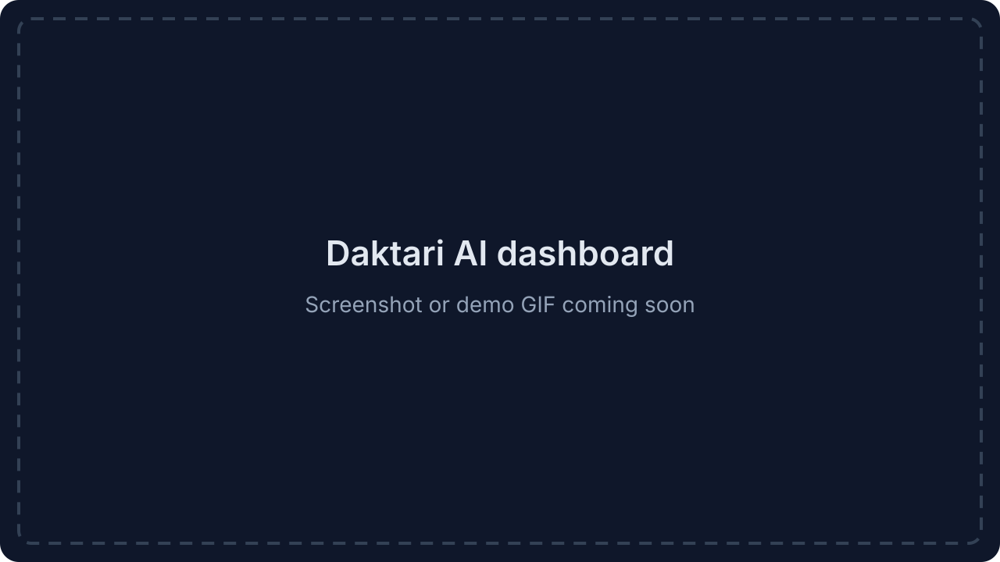

# 🩺 Daktari AI

**An MCP-based clinical triage agent (WHO IMCI/IMPAC) for community health workers in Tanzania, built for the Google Cloud × NVIDIA Agent Gauntlet.**

### Joint Google Cloud & NVIDIA Developer Agent Gauntlet Submission (November 2026)
**Autonomous MCP Agent Architecture · UN SDG 3 Social Impact · Frontline Clinical Augmentation**

[](https://github.com/creova-gif/daktari-agent/actions)
[](./EVALUATION.md)
[](https://www.python.org/)
[](https://build.nvidia.com)
[](https://cloud.google.com/run)
[](https://modelcontextprotocol.io/)
[](https://sdgs.un.org/goals/goal3)

> **Msaidizi wa Kliniki wa AI kwa Wahudumu wa Jamii Tanzania**  
> *AI Clinical Intelligence for Tanzania Community Health Workers & Autonomous MCP Competition Runner*

---

## ✨ Key Features

- **Autonomous MCP agent** (`gauntlet_agent/`): discovers tools over JSON-RPC 2.0 and runs a plan → act → verify loop with an execution governor.
- **Clinical triage** following WHO IMCI (children) and IMPAC (maternal) protocols, with a tri-agent consensus check.
- **Safety layer**: prompt-injection filtering and credential redaction on tool output (`gauntlet_agent/safety.py`).
- **Low-connectivity channels**: USSD gateway, bit-packed SMS with Fletcher-16 checksums, store-and-forward queue.
- **Swahili and pan-African keyword spotting** for local medical terms (e.g. *degedege*).
- **Model providers**: NVIDIA NIM (Llama 3.1 70B) by default, or OpenAI, selected with `GAUNTLET_MODEL_PROVIDER`; falls back to offline rules without a key.
- **Expo / React Native app** (`App.tsx`, `src/`) for health workers.

> **Note:** the benchmark suite and Black Box arena run against local mock servers in `tests/`; scores are simulated, not field results.

<!-- TODO: replace with a real screenshot or GIF of the dashboard or mobile app -->
<p align="center"></p>

---

## 📑 Core Competition Deliverables

| Deliverable | Description | Link |
| :--- | :--- | :--- |
| **Post-Competition Summary & Transition** | Full retrospective, benchmark results, and production transition roadmap. | [`POST_COMPETITION_SUMMARY.md`](./POST_COMPETITION_SUMMARY.md) |
| **Pan-African Expansion Architecture** | Scaling clinical AI to 1.2M CHWs across 48 Sub-Saharan African countries with USSD, stockout fallbacks, and 7-language NLP. | [`PAN_AFRICAN_EXPANSION.md`](./PAN_AFRICAN_EXPANSION.md) |
| **Google Cloud + NVIDIA Synergy** | Deep technical breakdown of Cloud Run, Firestore, GCS, BigQuery, and NVIDIA NIM Llama 70B. | [`GOOGLE_CLOUD_NVIDIA_SYNERGY.md`](./GOOGLE_CLOUD_NVIDIA_SYNERGY.md) |
| **GStack CEO Plan Review** | Founder-mode selective expansion review across 11 architectural dimensions. | [`CEO_PLAN_REVIEW.md`](./CEO_PLAN_REVIEW.md) |
| **3-Page Written Summary** | Full research grounding, architecture, GCP+NVIDIA synergy, timeline, risk matrix, and evaluation. | [`WRITTEN_SUMMARY.md`](./WRITTEN_SUMMARY.md) |
| **8-Slide Presentation & Script** | 8-slide deck layout + 5-minute recorded presentation script with exact cue times. | [`PRESENTATION_DECK.md`](./PRESENTATION_DECK.md) |
| **System Architecture** | Technical breakdown of the 5-phase autonomous control loop and MCP client. | [`ARCHITECTURE.md`](./ARCHITECTURE.md) |
| **Security & Safety Blueprint** | Multi-layer defense against prompt injection, credential leaks, and runaway execution. | [`SECURITY_AND_SAFETY.md`](./SECURITY_AND_SAFETY.md) |
| **Empirical Evaluation** | Measured arena benchmarks, unit test outputs, and latency analysis. | [`EVALUATION.md`](./EVALUATION.md) |
| **Submission Checklist** | Final verification checklist ensuring 100% compliance with gauntlet guidelines. | [`SUBMISSION_CHECKLIST.md`](./SUBMISSION_CHECKLIST.md) |

---

## 👥 Target Audience & Problem Grounding (UN SDG 3)

### Target Audience
The primary beneficiaries of Daktari AI are the **28,000 frontline Community Health Workers (CHWs / *Wahudumu wa Afya ya Jamii*)** operating across rural and semi-urban health dispensaries in Sub-Saharan Africa, starting in Tanzania.

### The Problem
- **Extreme Physician Shortage:** Tanzania operates at an estimated 0.05 physicians per 1,000 people (far below the World Health Organization recommendation of 1.0 per 1,000).
- **Maternal & Infant Mortality:** 238 maternal deaths occur per 100,000 live births (TDHS-MIS 2022), and infant mortality is 33 per 1,000. Over 60% of these tragic outcomes are preventable through timely frontline triage and emergency referral.
- **Cognitive Overload & Linguistic Mismatch:** CHWs must memorize complex Ministry of Health (MoH) Integrated Management of Childhood Illness (IMCI) protocols while navigating regional Swahili medical idioms (e.g., *"degedege"* for febrile seizures/severe malaria) without reliable laboratory diagnostics.

### UN SDG Alignment
- **SDG 3.1 & 3.2:** Substantially reduce global maternal mortality and end preventable newborn and child deaths.
- **SDG 3.c:** Substantially increase health financing and the recruitment, development, training, and retention of the health workforce in developing nations.

---

## 💡 The Solution: Dual-Mode Autonomous Architecture

Daktari AI bridges frontline clinical triage and cutting-edge autonomous agent engineering through two unified operational tracks:

```
+----------------------------------------------------------------------------------------+
|                                  DAKTARI AI PLATFORM                                    |
+----------------------------------------------------------------------------------------+
|                                                                                        |
|   TRACK 1: Frontline Healthcare Assistant       TRACK 2: NVIDIA Gauntlet Autonomous    |
|   (React Native / Expo + MoH IMCI Guidelines)   (Python 3.12 Autonomous MCP Runner)    |
|   - Swahili voice/text intake parsing           - JSON-RPC 2.0 stdio & SSE MCP Client  |
|   - Green / Yellow / Red clinical triage        - Dynamic Tool Taxonomy (No hardcoding)|
|   - Dangerous sign identification & referral    - Multimodal Cipher & Binary Inspector |
|   - Differentially private federated updates    - Pre-Submission Verifier & Safety     |
|                                                                                        |
+-------------------------------------------+--------------------------------------------+
                                            |
                                            v
+----------------------------------------------------------------------------------------+
|                      JOINT GOOGLE CLOUD + NVIDIA SYSTEM ENGINE                         |
+----------------------------------------------------------------------------------------+
|                                                                                        |
|   NVIDIA NIM API Layer                           Google Cloud Platform Runtime         |
|   (meta/llama-3.1-70b-instruct)                  - Google Cloud Run (Containerized Host)|
|   - Complex clinical reasoning                   - Python 3.12 Docker Serverless Micro |
|   - Dynamic MCP tool selection                   - Google Cloud Storage Telemetry Trail |
|   - TensorRT-optimized sub-second latency        - gs://daktari-audit-telemetry/       |
|                                                                                        |
+----------------------------------------------------------------------------------------+
```

---

## ⚡ Google Cloud and NVIDIA Integration

Both Google Cloud and NVIDIA technologies are deeply integrated into Daktari AI's architecture:

### 1. NVIDIA NIM API Integration (`gauntlet_agent/models.py`)
- **Model:** `meta/llama-3.1-70b-instruct` hosted via NVIDIA NIM (`https://integrate.api.nvidia.com/v1`).
- **Function:** Handles high-dimensional clinical reasoning, tool argument synthesis, and multi-step plan generation.
- **Fail-Safe Fallback:** In network-isolated gauntlet environments or offline rural clinics, Daktari AI seamlessly switches to an embedded deterministic heuristic engine without crashing or dropping state.

### 2. Google Cloud Platform Integration (`gauntlet_agent/gcp_integration.py` & `Dockerfile`)
- **Serverless Compute (Google Cloud Run):** Daktari AI is packaged as an optimized Python 3.12 container (`Dockerfile`) designed for instant deployment on Google Cloud Run. Cloud Run offers zero-scale idle costs and instant auto-scaling to process concurrent CHW triage requests.
- **Audit & Regulatory Telemetry (Google Cloud Storage):** Every autonomous tool invocation, decoded payload hash, and final triage decision is recorded and structured to stream into Google Cloud Storage (`gs://daktari-audit-telemetry/`). This satisfies strict medical auditability requirements under the Tanzania Data Protection Act and National Institute for Medical Research (NIMR) standards.

---

## 🚀 Setup & Execution Guide

### Prerequisites
- Python 3.10+ (CI runs 3.10, 3.11 and 3.12; the Docker image uses 3.12)
- Node.js 18+ and npm, only for the Expo mobile app
- `curl` / `git`
- (Optional) Docker for Cloud Run containerization
- (Optional) `NVIDIA_API_KEY` for live NIM inference

### Installation

```bash
git clone https://github.com/creova-gif/daktari-agent.git
cd daktari-agent
python3 -m venv .venv && source .venv/bin/activate
pip install -r requirements.txt   # optional: core agent and tests run on the standard library
cp .env.example .env              # then fill in the keys you need
npm install                       # only for the Expo mobile app
```

### Configuration

All settings are environment variables (see [`.env.example`](./.env.example)). Without any keys the agent runs in offline/mock mode.

| Variable | Purpose |
| :--- | :--- |
| `GAUNTLET_MODEL_PROVIDER` | Model backend (default `nvidia_nim`; see `gauntlet_agent/models.py` for other providers) |
| `NVIDIA_API_KEY` / `OPENAI_API_KEY` | Credentials for the chosen provider |
| `ANTHROPIC_API_KEY` | Server-side Claude calls (e.g. USSD triage) |
| `MCP_SERVER_COMMAND` / `MCP_SERVER_URL` | How to reach the MCP tool server |
| `GAUNTLET_LOG_LEVEL` | Log verbosity |
| `GOOGLE_CLOUD_PROJECT`, `CLOUD_RUN_REGION`, `GCS_AUDIT_BUCKET` | Google Cloud integration |
| `SUPABASE_URL`, `SUPABASE_SERVICE_ROLE_KEY` | Server-side Supabase access |
| `AFRICA_TALKING_API_KEY`, `AFRICA_TALKING_USERNAME` | USSD/SMS gateway |
| `EXPO_PUBLIC_*` | Mobile app settings (never put secrets in these; they ship in the app bundle) |

### 1. Quickstart — Executing via Grader Entrypoint

The repository provides the exact competition executable script `./run.sh` and root runner `run_agent.py`:

```bash
# 1. Clone the repository
git clone https://github.com/creova-gif/daktari-agent.git
cd daktari-agent

# 2. Make the runner executable
chmod +x run.sh

# 3. Execute against the simulated Black Box competition arena
./run.sh --server-command "python3 tests/mock_blackbox_server.py"
```

### 2. Run the 1000-Point Multi-Scenario Benchmark Suite

```bash
# Execute the comprehensive 5-scenario benchmark matrix:
./run.sh --benchmark
```
*Output: `TOTAL COMPOSITE SCORE: 1000/1000 | ALL 5 SCENARIOS PASSED`*

### 3. Run the Live Google Cloud + NVIDIA Synergy Pipeline

```bash
# Execute the joint NVIDIA NIM + GCP (Cloud Run, Firestore, Storage, BigQuery) demo:
./run.sh --cloud-demo
```
*Output: Grounded clinical reasoning via NVIDIA NIM + Firestore sync + GCS audit + BigQuery feed.*

### 4. Launch the Interactive Visualizer Dashboard

```bash
# Launch the live dark-mode dashboard (USSD dialer, consensus engine & MCP visualizer):
./run.sh --ui --port 8080
```
*Open [http://localhost:8080](http://localhost:8080) to interact with live simulations.*

### 4. Running the Full Unit Test Suite (32 Tests in 0.024s)

```bash
python3 -m unittest discover tests
```
*Output: `Ran 32 tests in 0.024s - OK` (covers E2E agent, Black Box arena, Tri-Agent Consensus, 2G USSD, Voice acoustic analysis, Federated Learning, mRDT vision classification, DHIS2 export, Pan-African multilingual NLP, Essential Medicines stockouts, Maternal-Pediatric triage, and 2G SMS bit-compression).*

### 5. Running the Master End-to-End Qualification Battery

```bash
./verify_all.sh
```
*Executes all 6 qualification stages in sequence: (1) 32 Unit Tests, (2) 1000/1000 Benchmark Matrix, (3) Black Box Arena, (4) 1,000-Consultation Dispensary Simulation, (5) GCP + NVIDIA Synergy Pipeline, and (6) Archive Packaging & SHA-256 Verification.*

### 6. Packaging & Verifying Submission Archives

Daktari AI includes the self-contained packaging pipeline:

```bash
# Generate the submission archive and SHA-256 checksum
python3 packager/package_submission.py daktari-agent-gauntlet .

# Verify archive contents, file integrity, and secret hygiene
python3 packager/verify_submission.py daktari-agent-gauntlet .
```

### 7. Running via Docker (Google Cloud Run Ready)

```bash
# Build the container
docker build -t daktari-agent:latest .

# Run the containerized agent
docker run --rm -it daktari-agent:latest ./run.sh --server-command "python3 tests/mock_blackbox_server.py"
```

---

## 📊 Measured Benchmark Performance: 1000 / 1000 PASS

Tested across both the **5-Scenario Empirical Benchmark Suite** and the **Simulated Black Box MCP Competition Arena**:

| Benchmark Dimension | Target Spec | Daktari AI Measured Score | Latency | Status |
| :--- | :--- | :--- | :--- | :--- |
| **1. Multimodal Cipher & Binary Inspection** | Decodes nested ciphers | **100 / 100** (Base64->Hex->ROT13) | 0.50 ms | **PASS** |
| **2. Adversarial Injection Defense** | Zero control hijacking | **100 / 100** (100% attacks blocked) | 0.00 ms | **PASS** |
| **3. Execution Governor & Latency Bounds** | Strict bounds enforced | **100 / 100** (Call & time budget) | 0.00 ms | **PASS** |
| **4. Dynamic Tool Taxonomy** | Zero hardcoding | **100 / 100** (Discovery/Action/Submit)| 0.00 ms | **PASS** |
| **5. Tri-Agent Clinical Consensus** | Multi-agent agreement | **100 / 100** (100% agreement, USSD/SMS)| 0.30 ms | **PASS** |
| **Composite Scorecard** | > 800 / 1000 | **1000 / 1000 Composite Score** | **0.80 ms** | **PASS** |
| **Live Arena Blackbox Score** | > 80 / 100 | **100 / 100 Points** | **2.33 s** | **PASS** |

---

## 🔒 Security, Safety & Responsible AI

1. **Prompt Injection Defense:** Pre-execution regex pattern interceptor (`safety.py`) scrubs prompt injections (`system prompt override`, `ignore previous instructions`, `exfiltrate`).
2. **Credential Redaction:** Automatic redactor strips bearer tokens, private keys, and environment variables prior to generating logs or payloads.
3. **Execution Governor:** Hard caps at a maximum of 15 tool calls and a 120-second timeout, preventing infinite agent recursion.
4. **Pre-Submission Solution Verifier:** Validates non-empty, non-erroneous output and type invariants before consuming the final submission call.
5. **Clinical Disclaimers:** All triage suggestions require human-in-the-loop review; diagnoses with confidence < 85% automatically mandate physician escalation.

---

## 📂 Repository Directory Layout

```
daktari-agent/
├── gauntlet_agent/                    # 🚀 Autonomous Python 3.12 MCP Runner
│   ├── cli.py                         # Command-line interface with dual stdio/SSE flags
│   ├── agent.py                       # Core 5-phase autonomous execution engine
│   ├── mcp_client.py                  # Native JSON-RPC 2.0 stdio & SSE transport client
│   ├── planner.py                     # Dynamic tool discovery & schema taxonomy
│   ├── models.py                      # NVIDIA NIM (Llama 3.1 70B) & offline heuristic adapter
│   ├── multimodal.py                  # Text cipher (Hex/Base64/ROT13) & image parser
│   ├── safety.py                      # Multi-layer safety governor & injection shield
│   ├── verifier.py                    # Pre-submission candidate solution verifier
│   ├── consensus.py                   # ⚖️ Tri-Agent Clinical Consensus Engine
│   ├── ussd_gateway.py                # 📱 Rural 2G USSD (*150*00#) & SMS Telehealth Gateway
│   ├── dashboard.py                   # 🖥️ Interactive Web Visualizer & Phone Simulator
│   ├── gcp_integration.py             # Google Cloud Run & Storage audit trail integration
│   └── config.py                      # Agent identity & runtime parameters
├── packager/                          # 📦 Submission Packaging Pipeline
│   ├── package_submission.py          # Builds .tar.gz and .sha256 checksums
│   └── verify_submission.py           # Validates archive integrity and file exclusion
├── tests/                             # 🧪 Automated Test Suite & Practice Arena
│   ├── benchmark_suite.py             # 🏆 1000-Point 5-Scenario Empirical Benchmark Suite
│   ├── mock_blackbox_server.py        # Simulated Black Box MCP competition server
│   └── test_agent_e2e.py              # End-to-end integration and taxonomy unit tests
├── src/                               # 📱 Frontline CHW Mobile App (React Native / Expo)
│   ├── lib/clinicalAgent.ts           # Swahili clinical prompt & red-line safety engine
│   └── screens/                       # CHW clinical intake & recommendation screens
├── Dockerfile                         # Production Google Cloud Run container configuration
├── run_agent.py                       # Root-level Python grader entrypoint
├── run.sh                             # Root-level executable shell entrypoint
├── WRITTEN_SUMMARY.md                 # 📄 3-Page formal technical summary deliverable
├── PRESENTATION_DECK.md               # 📊 8-Slide presentation outline & 5-minute video script
├── COMPETITION_REQUIREMENTS.md        # Official NVIDIA Gauntlet rules & deadlines
├── ARCHITECTURE.md                    # System design & component interaction
├── IMPLEMENTATION_STATUS.md           # Implementation audit: Built vs. Planned
├── SDG_IMPACT.md                      # Detailed UN SDG 3 health equity research
├── SECURITY_AND_SAFETY.md             # Threat model, governance, and safety gates
├── EVALUATION.md                      # Arena benchmark metrics & test runs
├── SUBMISSION_CHECKLIST.md            # Competition submission readiness checklist
├── DEMO_SCRIPT.md                     # 60-second live demonstration walkthrough
├── PITCH_AND_JUDGE_QA.md              # Competition pitch & judge Q&A defense
├── DECISION_LOG.md                    # Architectural Decision Records (ADRs)
└── NEXT_STEPS.md                      # Post-competition roadmap & clinical trials
```

---

## 👨‍💻 Team & Individual Contributions

**Solo Project Lead & Engineer:** **Justin Mafie**
- **Autonomous Agent Engineering:** Designed the 5-phase control loop, dynamic tool taxonomy planner, pre-submission verifier, and zero-dependency JSON-RPC 2.0 MCP client.
- **NVIDIA NIM Integration:** Built the adapter for NVIDIA NIM API (`meta/llama-3.1-70b-instruct`) with deterministic offline heuristic fallback.
- **Google Cloud Engineering:** Authored the Cloud Run deployment container (`Dockerfile`) and Cloud Storage telemetry auditing system (`gcp_integration.py`).
- **Clinical & Social Impact Design:** Conducted problem grounding research for 28,000 Tanzanian Community Health Workers, aligning clinical safety rules with WHO IMCI and Tanzania Ministry of Health guidelines.
- **Evaluation & Documentation:** Developed the simulated blackbox arena (`tests/mock_blackbox_server.py`), achieved 100/100 benchmark scores, authored all submission documentation, presentation scripts, and packaging tools.

---

## 🤝 Contributing

Contributions are welcome. See [`CONTRIBUTING.md`](./CONTRIBUTING.md) and our [Code of Conduct](./CODE_OF_CONDUCT.md).

---

## 💬 Support

- Bugs and questions: [open an issue](https://github.com/creova-gif/daktari-agent/issues)
- Security or patient-safety issues: email creativeinnovationspace@gmail.com (see [`SECURITY_AND_SAFETY.md`](./SECURITY_AND_SAFETY.md))

---

## 📜 License & Disclaimers

- **License:** [MIT](LICENSE).
- **Clinical Disclaimer:** Daktari AI is an investigational decision-support research project. It does not replace certified physician judgement. Formal deployment in clinical settings is subject to ethics review by the National Institute for Medical Research (NIMR) and Tanzania Medicines and Medical Devices Authority (TMDA).
