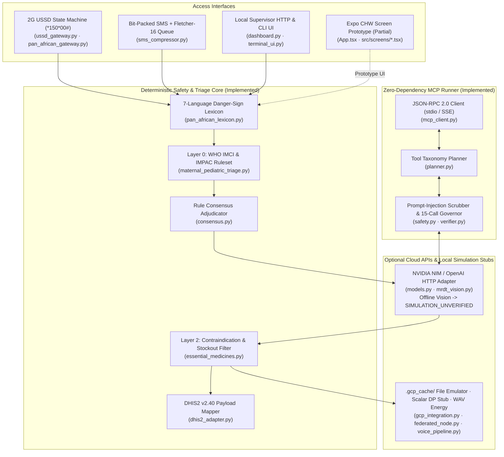

# Daktari Agent (`daktari-agent`)

**Zero-dependency Model Context Protocol (MCP) clinical-triage runner, deterministic WHO IMCI/IMPAC danger-sign ruleset, and 2G USSD/SMS decision-support prototype.**

[](https://github.com/creova-gif/daktari-agent/actions/workflows/ci.yml)
[](./LICENSE)
[](https://www.python.org/)
[](https://modelcontextprotocol.io/)

> [!IMPORTANT]
> **Investigational Research & Implementation Honesty Notice:**
> Daktari Agent is an **investigational software prototype and MCP safety architecture**, not an approved medical device. See [**IMPLEMENTATION_STATUS.md**](./IMPLEMENTATION_STATUS.md) for the complete module-by-module audit:
> - **Implemented & Verified:** Zero-dependency Python JSON-RPC 2.0 MCP client/planner/governor, deterministic WHO IMCI & IMPAC danger-sign triage rules, essential-medicines contraindication & stockout substitutions, 2G USSD (`*150*00#`) & bit-packed Fletcher-16 SMS state machines, and Tanzania MoH DHIS2 `dataValueSets` JSON/XML mapping.
> - **Simulated / Offline Stubs:** `gcp_integration.py` writes strictly to a local `.gcp_cache/` folder (no live GCP SDK calls), `mrdt_vision.py` returns `SIMULATION_UNVERIFIED` offline unless passed an explicit `Comment\x00MRDT_*` synthetic test fixture or live `NVIDIA_API_KEY`, `federated_node.py` simulates scalar DP averages (not PyTorch LoRA tensors), and `voice_pipeline.py` computes WAV PCM RMS/ZCR energy without ASR transcription.
> - **UI Prototype (Partial):** `App.tsx` and `src/screens/*.tsx` provide 14 React Native / Expo screen layouts (`supabase/migrations/` schemas included), while client helper bindings (`src/lib/*`) remain decoupled pending backend API integration.

---

## 1. Current Implementation Status Summary

| Category | Modules | Status | Summary |
| :--- | :--- | :--- | :--- |
| **Zero-Dep MCP Agent & Safety Shield** | [`mcp_client.py`](./gauntlet_agent/mcp_client.py), [`planner.py`](./gauntlet_agent/planner.py), [`safety.py`](./gauntlet_agent/safety.py), [`verifier.py`](./gauntlet_agent/verifier.py), [`agent.py`](./gauntlet_agent/agent.py) | **Implemented & Verified** | Native `stdio`/SSE JSON-RPC 2.0 MCP client, dynamic tool taxonomy planner, prompt-injection scrubber, secret redactor, and 15-call / 120s governor; tested in [`tests/test_agent_e2e.py`](./tests/test_agent_e2e.py). |
| **Deterministic Clinical Triage & Medication Rules** | [`maternal_pediatric_triage.py`](./gauntlet_agent/maternal_pediatric_triage.py), [`consensus.py`](./gauntlet_agent/consensus.py), [`essential_medicines.py`](./gauntlet_agent/essential_medicines.py), [`pan_african_lexicon.py`](./gauntlet_agent/pan_african_lexicon.py) | **Implemented & Verified** | Age-stratified WHO IMCI respiratory/MUAC danger signs, maternal IMPAC hemorrhage/pre-eclampsia triggers, 7-language danger-sign lexicon, and contraindication/stockout rules; tested in [`tests/test_pan_african.py`](./tests/test_pan_african.py) & [`tests/test_consensus_ussd.py`](./tests/test_consensus_ussd.py). |
| **2G USSD, Bit-Packed SMS & DHIS2 Export** | [`ussd_gateway.py`](./gauntlet_agent/ussd_gateway.py), [`pan_african_gateway.py`](./gauntlet_agent/pan_african_gateway.py), [`sms_compressor.py`](./gauntlet_agent/sms_compressor.py), [`dhis2_adapter.py`](./gauntlet_agent/dhis2_adapter.py) | **Implemented & Verified** | 4-hop `≤160`-char USSD session engine, `<60`-char Fletcher-16 Base64 SMS store-and-forward queue, and DHIS2 v2.40 `dataValueSets` serializer; tested in [`tests/test_mrdt_and_dhis2.py`](./tests/test_mrdt_and_dhis2.py). |
| **Pluggable Remote LLM / Vision Callers** | [`models.py`](./gauntlet_agent/models.py), [`mrdt_vision.py`](./gauntlet_agent/mrdt_vision.py) | **Optional Remote API + Safe Offline Fallback** | Calls NVIDIA NIM / OpenAI HTTP endpoints when `NVIDIA_API_KEY` / `OPENAI_API_KEY` is configured. Offline `mrdt_vision.py` fails closed with `SIMULATION_UNVERIFIED` on untagged images. |
| **Local Cloud, Federated & Audio Stubs** | [`gcp_integration.py`](./gauntlet_agent/gcp_integration.py), [`cloud_synergy.py`](./gauntlet_agent/cloud_synergy.py), [`federated_node.py`](./gauntlet_agent/federated_node.py), [`voice_pipeline.py`](./gauntlet_agent/voice_pipeline.py) | **Simulated / Local Offline Stubs** | Local `.gcp_cache/` file emulator, 4-scalar differential-privacy toy aggregator, and WAV PCM amplitude/ZCR calculator for offline architecture prototyping. |
| **Expo Mobile Screens & SQL Migrations** | [`App.tsx`](./App.tsx), [`src/screens/`](./src/screens/), [`supabase/migrations/`](./supabase/migrations/) | **UI Prototype (Partial)** | 14 React Native / Expo CHW intake & dashboard screen prototypes + PostgreSQL migration scripts (`src/lib/*` client helpers not bundled; requires backend API wiring). |
| **Clinical Validation & Cloud SDK Wiring** | [`IMPLEMENTATION_STATUS.md`](./IMPLEMENTATION_STATUS.md) | **Planned / Roadmap** | Live `google-cloud-*` SDK adapters, Whisper Swahili ASR, PyTorch federated LoRA, and NIMR / TMDA / MUHAS prospective study clearance. |

---

## 2. Problem Statement & Architectural Motivation

Community Health Workers (CHWs) and rural dispensaries across East Africa frequently operate under intermittent 2G connectivity and drug stockouts. Relying purely on unconstrained LLM completions for clinical triage introduces unacceptable safety risks: hallucinated drug dosages, missed pediatric/maternal danger signs, or false confidence when vision/ASR models are unreachable.

**Daktari Agent** explores a **deterministic safety-sandwich architecture**: probabilistic LLM calls are optional middle-layer normalizers, bookended by hard pre-LLM danger-sign triggers (Layer 0) and post-LLM medication contraindication/stockout filters (Layer 2), exposed over both standard JSON-RPC 2.0 MCP tools and 160-character 2G USSD state machines.

---

## 3. System Architecture



---

## 4. Engineering Decisions & Trade-Offs

Detailed records are maintained in [`DECISION_LOG.md`](./DECISION_LOG.md) and [`docs/adr/0001-deterministic-clinical-safety-guardrails.md`](./docs/adr/0001-deterministic-clinical-safety-guardrails.md):

1. **Deterministic Clinical Guardrails Over Unconstrained LLM Triage:**
   - Age-stratified WHO IMCI respiratory rate thresholds (`≥60 bpm` `<2m`, `≥50 bpm` `2–12m`, `≥40 bpm` `1–5y`), severe wasting (`MUAC < 11.5 cm`), convulsions, postpartum hemorrhage (`≥500 mL`), and severe pre-eclampsia (`BP ≥ 160/110 mmHg`) execute in pure deterministic Python (`maternal_pediatric_triage.py`) so emergency `RED` referrals never depend on network availability or model sampling.
2. **Fail-Closed Offline Vision Fallback (`SIMULATION_UNVERIFIED`):**
   - In clinical decision support, an offline fallback must **never** guess `POSITIVE` or `NEGATIVE` from arbitrary image bytes. When `NVIDIA_API_KEY` is absent, `MRDTAnalyzer.analyze_cassette_image()` returns `SIMULATION_UNVERIFIED` (`confidence = 0.0`) for all untagged images, only resolving explicit `Comment\x00MRDT_*` synthetic PNG test fixtures (`is_simulation = True`) for pipeline unit tests.
3. **Zero-Dependency Core Verification Loop:**
   - The MCP client, triage engine, USSD state machine, SMS bit-packer, and safety governor rely strictly on the Python `3.10+` standard library so the entire verification suite runs cleanly in `<3s` without external services.

---

## 5. Prerequisites & Quickstart

### Prerequisites
- **Python 3.10+** (verified in CI across Python `3.10`, `3.11`, and `3.12`)

### 1. Clone & Configure

```bash
git clone https://github.com/creova-gif/daktari-agent.git
cd daktari-agent
python3 -m venv .venv
source .venv/bin/activate
pip install -r requirements.txt
cp .env.example .env
```

### 2. Run Automated Tests & Synthetic Verification Suite

```bash
# Run unit, triage, USSD, MCP E2E, DHIS2, and fail-closed mRDT safety tests
python3 -m unittest discover -s tests -v

# Run the full 6-stage synthetic regression & packaging battery (used in CI)
./verify_all.sh
```

> **Note on `verify_all.sh`:** Stages 2–5 execute local deterministic software regression harnesses (`tests/benchmark_suite.py`, `tests/mock_blackbox_server.py`, `tests/dispensary_simulator.py`, and `.gcp_cache/` offline emulation) to verify zero-crash execution, prompt-injection scrubbing, and rule consistency — they are not live cloud or clinical trial benchmarks.

### 3. Launch the Local USSD & Consensus Supervisor UI

```bash
./run.sh --ui --port 8080
```
Open `http://127.0.0.1:8080` to test the 2G USSD dialer state machine, WHO IMCI danger-sign rules, and MCP tool trace viewer locally.

---

## 6. Configuration & Environment Variables

Configured via environment variables (see [`.env.example`](./.env.example); never expose LLM keys with `EXPO_PUBLIC_`):

| Variable | Default | Description |
| :--- | :--- | :--- |
| `GAUNTLET_MODEL_PROVIDER` | `nvidia_nim` | Remote LLM adapter (`nvidia_nim`, `openai`, or `heuristic`) |
| `NVIDIA_API_KEY` | *(unset)* | Optional NVIDIA NIM API key (`meta/llama-3.1-70b-instruct` & vision) |
| `OPENAI_API_KEY` | *(unset)* | Optional server-side OpenAI API key |
| `MCP_SERVER_COMMAND` | *(unset)* | Subprocess command for `stdio` MCP server attachment |
| `MCP_SERVER_URL` | *(unset)* | Remote HTTP SSE endpoint for MCP server attachment |
| `GAUNTLET_LOG_LEVEL` | `INFO` | Logger verbosity (`DEBUG`, `INFO`, `WARNING`, `ERROR`) |

---

## 7. Security, Known Limitations & License

- **Security & Clinical Safety Policy:** See [`SECURITY.md`](./SECURITY.md) and [`SECURITY_AND_SAFETY.md`](./SECURITY_AND_SAFETY.md) (report vulnerabilities privately to `security@creova.one`).
- **Known Limitations:**
  - `gcp_integration.py` is a local `.gcp_cache/` file emulator; live GCP SDK clients are not yet wired.
  - `federated_node.py` and `voice_pipeline.py` are offline algorithmic/signal stubs rather than PyTorch LoRA or Whisper ASR pipelines.
  - `src/screens/*.tsx` is a partial Expo UI prototype requiring client library (`src/lib/*`) restoration and backend API wiring before standalone mobile compilation.
- **Contributing & Governance:** See [`CONTRIBUTING.md`](./CONTRIBUTING.md), [`CODE_OF_CONDUCT.md`](./CODE_OF_CONDUCT.md), and [`AGENTS.md`](./AGENTS.md).
- **License:** Distributed under the [MIT License](./LICENSE).
