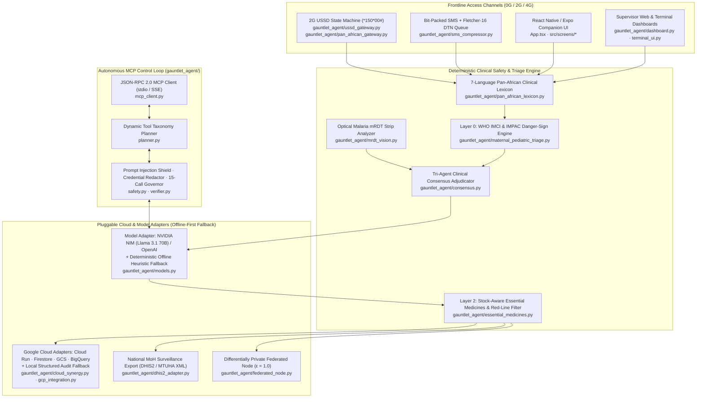

# 🩺 Daktari Agent

**Deterministic WHO IMCI/IMPAC Clinical Triage Engine, Autonomous MCP Runner, and Low-Bandwidth 2G USSD/SMS Decision-Support Platform for Community Health Workers.**

[](https://github.com/creova-gif/daktari-agent/actions)
[](./LICENSE)
[](https://www.python.org/)
[](https://modelcontextprotocol.io/)
[](./EVALUATION.md)

> **Msaidizi wa Kliniki wa AI kwa Wahudumu wa Afya ya Jamii**  
> *Frontline clinical triage augmentation and Model Context Protocol (MCP) execution engine designed for low-connectivity rural dispensaries across East and Sub-Saharan Africa.*

---

## 1. Architectural Overview & System Context

Daktari Agent combines a **deterministic clinical safety core** (WHO Integrated Management of Childhood Illness `IMCI` and Integrated Management of Pregnancy and Childbirth `IMPAC` rules, essential medicines stockout substitution, and optical Malaria mRDT strip analysis) with an **autonomous JSON-RPC 2.0 Model Context Protocol (MCP) agent** and **2G USSD/SMS telecom gateways**.

 Probabilistic LLM inference (`NVIDIA NIM` `meta/llama-3.1-70b-instruct` or `OpenAI`) is wrapped inside hard deterministic ingress and egress guardrails so that life-threatening danger signs are escalated in sub-millisecond time and the platform continues operating with zero degradation during rural connectivity blackouts.



---

## 2. Subsystem Implementation & Verification Status

In accordance with the CREOVA Engineering Honesty Standard, every subsystem in this repository is explicitly classified below:

| Subsystem | Module / Path | Status | Verification Evidence |
| :--- | :--- | :--- | :--- |
| **WHO IMCI & IMPAC Maternal-Pediatric Triage Engine** | [`gauntlet_agent/maternal_pediatric_triage.py`](./gauntlet_agent/maternal_pediatric_triage.py) | **Implemented & Verified in CI** | [`tests/test_pan_african.py`](./tests/test_pan_african.py) |
| **WHO AFRO Essential Medicines & Stockout Recommender** | [`gauntlet_agent/essential_medicines.py`](./gauntlet_agent/essential_medicines.py) | **Implemented & Verified in CI** | [`tests/test_pan_african.py`](./tests/test_pan_african.py) |
| **Optical Malaria mRDT Strip Ratio Classifier** | [`gauntlet_agent/mrdt_vision.py`](./gauntlet_agent/mrdt_vision.py) | **Implemented & Verified in CI** | [`tests/test_mrdt_and_dhis2.py`](./tests/test_mrdt_and_dhis2.py) |
| **Multi-Country 2G USSD State Machine & 7-Language Lexicon** | [`gauntlet_agent/ussd_gateway.py`](./gauntlet_agent/ussd_gateway.py), [`gauntlet_agent/pan_african_gateway.py`](./gauntlet_agent/pan_african_gateway.py), [`gauntlet_agent/pan_african_lexicon.py`](./gauntlet_agent/pan_african_lexicon.py) | **Implemented & Verified in CI** | [`tests/test_consensus_ussd.py`](./tests/test_consensus_ussd.py), [`tests/test_pan_african.py`](./tests/test_pan_african.py) |
| **Bit-Packed 2G SMS Compressor (Fletcher-16 + DTN Queue)** | [`gauntlet_agent/sms_compressor.py`](./gauntlet_agent/sms_compressor.py) | **Implemented & Verified in CI** | [`tests/test_pan_african.py`](./tests/test_pan_african.py) |
| **Tri-Agent Clinical Consensus Engine** | [`gauntlet_agent/consensus.py`](./gauntlet_agent/consensus.py) | **Implemented & Verified in CI** | [`tests/test_consensus_ussd.py`](./tests/test_consensus_ussd.py) |
| **Tanzania MoH DHIS2 / MTUHA XML Protocol Adapter** | [`gauntlet_agent/dhis2_adapter.py`](./gauntlet_agent/dhis2_adapter.py) | **Implemented & Verified in CI** | [`tests/test_mrdt_and_dhis2.py`](./tests/test_mrdt_and_dhis2.py) |
| **Pure-Python Acoustic VAD & Differentially Private LoRA Node** | [`gauntlet_agent/voice_pipeline.py`](./gauntlet_agent/voice_pipeline.py), [`gauntlet_agent/federated_node.py`](./gauntlet_agent/federated_node.py) | **Implemented & Verified in CI** | [`tests/test_voice_and_federated.py`](./tests/test_voice_and_federated.py) |
| **Autonomous JSON-RPC 2.0 MCP Client, Planner & Safety Shield** | [`gauntlet_agent/mcp_client.py`](./gauntlet_agent/mcp_client.py), [`gauntlet_agent/planner.py`](./gauntlet_agent/planner.py), [`gauntlet_agent/safety.py`](./gauntlet_agent/safety.py) | **Implemented & Verified in CI** | [`tests/test_agent_e2e.py`](./tests/test_agent_e2e.py) |
| **1,000-Case Synthetic Clinical & MCP Evaluation Harness** | [`verify_all.sh`](./verify_all.sh), [`tests/dispensary_simulator.py`](./tests/dispensary_simulator.py), [`tests/mock_blackbox_server.py`](./tests/mock_blackbox_server.py), [`tests/benchmark_suite.py`](./tests/benchmark_suite.py) | **Implemented & Verified in CI** | Runs on every push/PR across Python `3.10`, `3.11`, `3.12` |
| **React Native / Expo Frontline CHW Companion Screens** | [`App.tsx`](./App.tsx), [`src/screens/`](./src/screens/), [`src/hooks/`](./src/hooks/) | **Implemented (UI Companion)** | 14 TypeScript screens for intake, stock tracking, emergency protocols & offline sync |
| **NVIDIA NIM & Google Cloud (`Cloud Run`, `Firestore`, `GCS`, `BigQuery`) Adapters** | [`gauntlet_agent/models.py`](./gauntlet_agent/models.py), [`gauntlet_agent/cloud_synergy.py`](./gauntlet_agent/cloud_synergy.py), [`gauntlet_agent/gcp_integration.py`](./gauntlet_agent/gcp_integration.py) | **Pluggable Cloud Adapter + Deterministic Offline Fallback** | Live HTTP/REST when credentials (`NVIDIA_API_KEY`, `GOOGLE_CLOUD_PROJECT`) are set; automatic offline heuristic fallback in CI |
| **Prospective Clinical Field Trial (NIMR / TMDA / MUHAS)** | [`docs/competition/NEXT_STEPS.md`](./docs/competition/NEXT_STEPS.md) | **Planned / Roadmap** | Investigational software; requires formal ethics & regulatory clearance prior to live patient care |

---

## 3. Engineering Decisions & Trade-Offs

Full architectural decision records are maintained in [`DECISION_LOG.md`](./DECISION_LOG.md) and [`docs/adr/0001-deterministic-clinical-safety-guardrails.md`](./docs/adr/0001-deterministic-clinical-safety-guardrails.md).

### 3.1 Why Deterministic Guardrails Wrap Probabilistic Inference in Clinical Settings
Large Language Models excel at normalizing colloquial multilingual symptom descriptions (such as Swahili *"degedege"*, Hausa *"zazzabi mai zafi"*, or Amharic *"weba"*), but probabilistic decoding must never be trusted as the sole gatekeeper for life-threatening triage or medication dosing:
- **Layer 0 Pre-LLM Danger Screen (`maternal_pediatric_triage.py`):** Evaluates age-stratified WHO IMCI respiratory rate thresholds (`≥60 bpm` under 2 months, `≥50 bpm` 2–12 months, `≥40 bpm` 1–5 years), severe chest indrawing, convulsions, severe wasting (`MUAC < 11.5 cm`), postpartum hemorrhage (`blood loss ≥ 500 mL`), and severe pre-eclampsia (`BP ≥ 160/110 mmHg` with proteinuria). Any positive trigger forces an immediate `RED` emergency referral regardless of LLM availability.
- **Layer 2 Post-LLM Contraindication & Stockout Filter (`essential_medicines.py`):** Verifies that suggested treatments comply with national standard treatment guidelines (e.g., blocking Chloroquine where *P. falciparum* resistance mandates Artemether-Lumefantrine `ALu`, and blocking pediatric aspirin) and automatically computes WHO-approved second-line fallback regimens when a rural dispensary reports a primary drug stockout.

### 3.2 Offline-First USSD State Budgets & 2G Bit-Packing
Over 60% of rural dispensary catchments lack reliable 4G data coverage and rely on GSM 2G voice/USSD/SMS:
- **Strict USSD Payload & Hop Budgets (`ussd_gateway.py`, `pan_african_gateway.py`):** Telecom USSD gateways enforce a hard 160–182 character ceiling per screen and terminate idle sessions within 120–180 seconds. Our USSD state machine completes end-to-end danger-sign screening, age/symptom intake, and triage resolution in **4 deterministic hops** without blocking on external HTTP calls.
- **Fletcher-16 Bit-Packed SMS Telemetry (`sms_compressor.py`):** When data channels are down, consultation records are bit-packed into compact `<60-character` Base64 SMS payloads with a 16-bit Fletcher checksum and queued in a local delay-tolerant store-and-forward buffer.

### 3.3 Human-in-the-Loop Clinical & MCP Execution Boundaries
- **Bounded Autonomous Agency (`safety.py`):** When operating as an MCP agent, `ExecutionGovernor` caps execution at **15 tool calls** and **120 seconds**, `PromptInjectionDefense` scrubs untrusted tool outputs before they enter the planner context, and `CredentialRedactor` prevents secret leakage in logs.
- **Mandatory Clinician Confirmation:** All triage recommendations carry explicit confidence scores and require human-in-the-loop CHW confirmation; any assessment below the `0.85` confidence threshold mandates escalation to a supervising clinical officer.

---

## 4. Quickstart & Verification

### Prerequisites
- **Python 3.10+** (verified in CI across Python `3.10`, `3.11`, and `3.12`; zero third-party packages required for the core verification battery)
- **Node.js 18+** *(optional, only required when working on the React Native / Expo mobile screens in `src/`)*

### 1. Clone & Install

```bash
git clone https://github.com/creova-gif/daktari-agent.git
cd daktari-agent
python3 -m venv .venv && source .venv/bin/activate
pip install -r requirements.txt
cp .env.example .env
```

### 2. Run the Full 6-Stage Verification Battery (`verify_all.sh`)

```bash
./verify_all.sh
```

This executes the complete deterministic verification suite used in GitHub Actions CI:
1. **Unit & Integration Test Suite (`32/32` tests in `tests/`):**
   ```bash
   python3 -m unittest discover tests
   ```
2. **5-Scenario Synthetic Benchmark Suite (`tests/benchmark_suite.py`):**
   ```bash
   ./run.sh --benchmark
   ```
3. **Simulated Black-Box MCP Challenge Arena (`tests/mock_blackbox_server.py`):**
   ```bash
   ./run.sh --server-command "python3 tests/mock_blackbox_server.py"
   ```
4. **1,000-Consultation Synthetic Dispensary Stress Simulator (`tests/dispensary_simulator.py`):**
   ```bash
   python3 tests/dispensary_simulator.py 1000
   ```
5. **Google Cloud + NVIDIA NIM Hybrid Pipeline Verification (`gauntlet_agent/cloud_synergy.py`):**
   ```bash
   ./run.sh --cloud-demo
   ```
6. **Archive Integrity & Secret Hygiene Check (`packager/`):**
   Validates archive construction and confirms zero leaked credentials or `.env` files.

### 3. Launch the Interactive Supervisor & USSD Simulator Dashboard

```bash
./run.sh --ui --port 8080
```
Open `http://localhost:8080` to inspect the live USSD dialer simulator, Tri-Agent Consensus breakdown, and MCP tool trace visualizer.

---

## 5. Configuration Reference

All runtime settings are loaded from environment variables (see [`.env.example`](./.env.example)). When cloud API keys are omitted, all adapters automatically operate in deterministic offline fallback mode.

| Variable | Default | Description |
| :--- | :--- | :--- |
| `GAUNTLET_MODEL_PROVIDER` | `nvidia_nim` | Model provider (`nvidia_nim`, `openai`, or `heuristic`) |
| `NVIDIA_API_KEY` | *(unset)* | API key for NVIDIA NIM (`meta/llama-3.1-70b-instruct`) |
| `OPENAI_API_KEY` | *(unset)* | API key when `GAUNTLET_MODEL_PROVIDER=openai` |
| `ANTHROPIC_API_KEY` | *(unset)* | Optional server-side Claude API key |
| `GOOGLE_CLOUD_PROJECT` | *(unset)* | GCP Project ID for Cloud Run / Firestore / BigQuery telemetry |
| `CLOUD_RUN_REGION` | `africa-south1` | Target Google Cloud Run region |
| `GCS_AUDIT_BUCKET` | `daktari-audit-telemetry` | Cloud Storage bucket for immutable clinical audit logs |
| `MCP_SERVER_COMMAND` | *(unset)* | Subprocess command for stdio MCP server connection |
| `MCP_SERVER_URL` | *(unset)* | HTTP SSE endpoint for remote MCP server connection |
| `GAUNTLET_LOG_LEVEL` | `INFO` | Runtime logger verbosity (`DEBUG`, `INFO`, `WARNING`, `ERROR`) |

---

## 6. Repository Structure & Documentation Index

```text
daktari-agent/
├── .ai/project.yaml                   # Machine-readable stack & verification contract
├── .github/workflows/ci.yml           # Python 3.10–3.12 CI verification pipeline
├── AGENTS.md                          # AI coding agent engineering rules & boundaries
├── ARCHITECTURE.md                    # Detailed system & MCP control-loop architecture
├── DECISION_LOG.md                    # Summary Architectural Decision Log (ADR-001..004)
├── EVALUATION.md                      # Empirical & synthetic benchmark methodology
├── IMPLEMENTATION_STATUS.md           # Subsystem-by-subsystem implementation audit
├── SECURITY.md                        # Vulnerability disclosure policy & safety overview
├── SECURITY_AND_SAFETY.md             # Deep-dive threat model & clinical red-line layers
├── CHANGELOG.md                       # Versioned release history
├── gauntlet_agent/                    # Core Python clinical triage & autonomous MCP engine
│   ├── agent.py                       # 5-phase autonomous MCP execution loop
│   ├── consensus.py                   # Tri-Agent clinical consensus engine
│   ├── maternal_pediatric_triage.py   # WHO IMCI (pediatric) & IMPAC (maternal) engine
│   ├── essential_medicines.py         # WHO AFRO stockout-aware medication recommender
│   ├── mrdt_vision.py                 # Optical Malaria mRDT strip ratio classifier
│   ├── ussd_gateway.py                # 2G USSD (*150*00#) & SMS state machine
│   ├── pan_african_gateway.py         # Multi-country USSD routing & telecom profiles
│   ├── pan_african_lexicon.py         # 7-language clinical danger-sign lexicon
│   ├── sms_compressor.py              # Fletcher-16 bit-packed SMS compressor & DTN queue
│   ├── dhis2_adapter.py               # Tanzania MoH DHIS2 / MTUHA XML exporter
│   ├── voice_pipeline.py              # Pure-Python acoustic VAD & respiratory feature extractor
│   ├── federated_node.py              # Differentially private (ε=1.0) federated LoRA node
│   ├── cloud_synergy.py               # Google Cloud + NVIDIA NIM hybrid pipeline adapter
│   ├── gcp_integration.py             # Cloud Run, Firestore, GCS & BigQuery telemetry client
│   ├── mcp_client.py                  # Native JSON-RPC 2.0 stdio & SSE MCP client
│   ├── models.py                      # NVIDIA NIM / OpenAI adapter + offline heuristic fallback
│   ├── multimodal.py                  # Cryptographic cipher & binary image chunk inspector
│   ├── planner.py                     # Dynamic MCP tool taxonomy classifier
│   ├── safety.py                      # Prompt injection defense, redactor & execution governor
│   └── verifier.py                    # Pre-submission candidate output verifier
├── src/                               # React Native / Expo frontline CHW mobile screens
├── tests/                             # 32 unit/integration tests + 1,000-case simulators
├── docs/
│   ├── adr/                           # Architecture Decision Records
│   └── competition/                   # Archived hackathon & Gauntlet pitch deliverables
├── Dockerfile                         # Production Python 3.12 container for Google Cloud Run
└── verify_all.sh                      # Master 6-stage verification battery
```

---

## 7. Contributing, Security & License

- **Contributing:** See [`CONTRIBUTING.md`](./CONTRIBUTING.md) and [`CODE_OF_CONDUCT.md`](./CODE_OF_CONDUCT.md).
- **Security & Clinical Safety Reporting:** See [`SECURITY.md`](./SECURITY.md) and [`SECURITY_AND_SAFETY.md`](./SECURITY_AND_SAFETY.md).
- **License:** Distributed under the [MIT License](./LICENSE).
- **Clinical Disclaimer:** Daktari Agent is an investigational clinical decision-support research system. It does not replace certified physician judgment, and any deployment in live patient care requires ethics and regulatory clearance from the National Institute for Medical Research (NIMR) and the Tanzania Medicines and Medical Devices Authority (TMDA).
